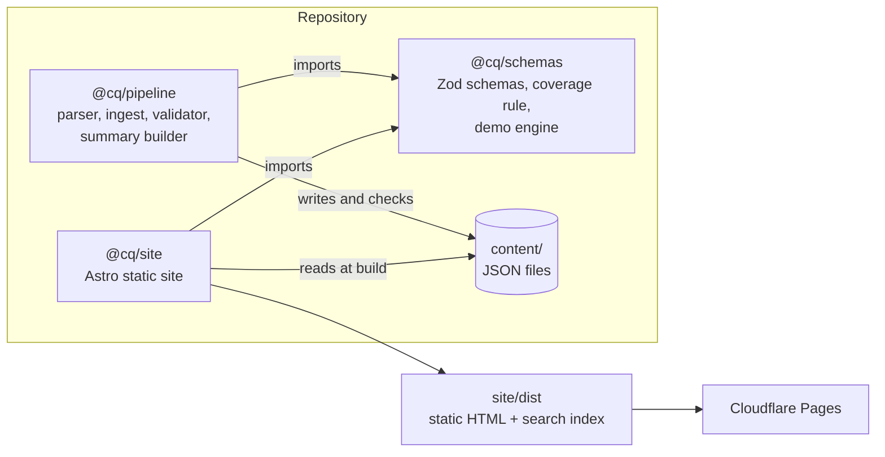
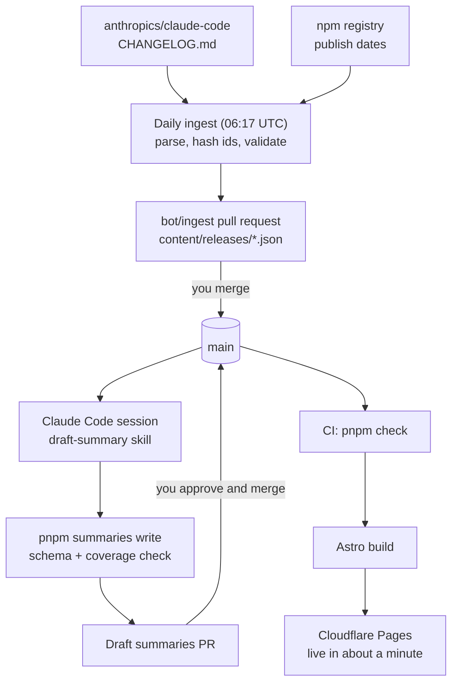
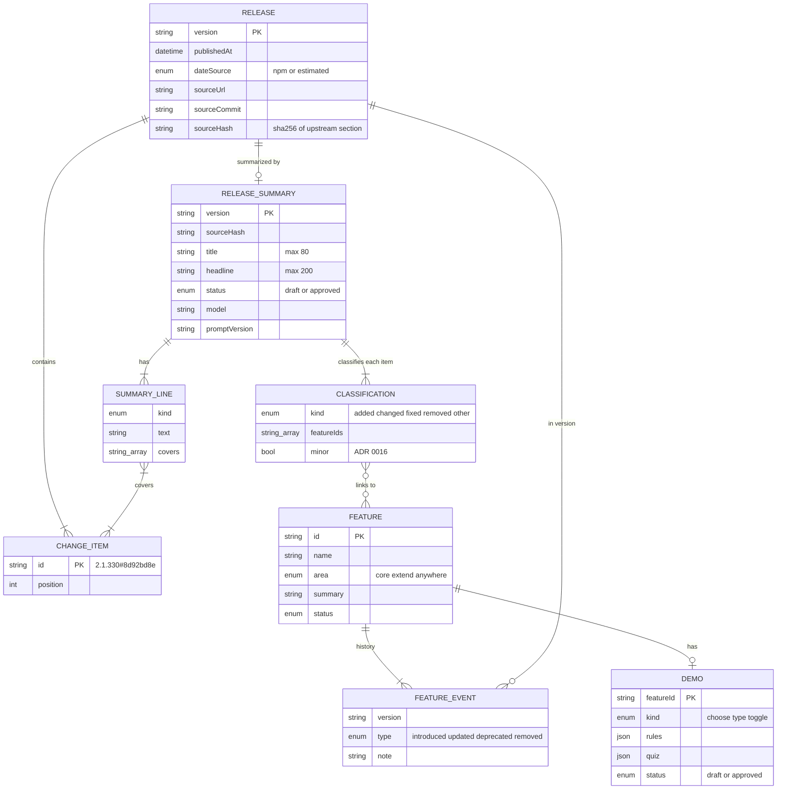
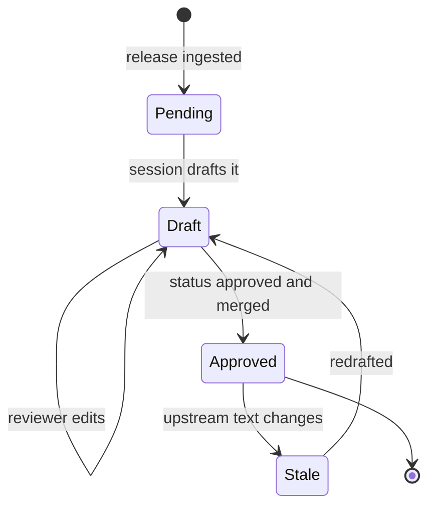
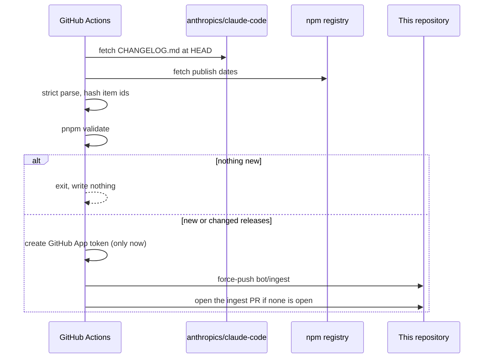
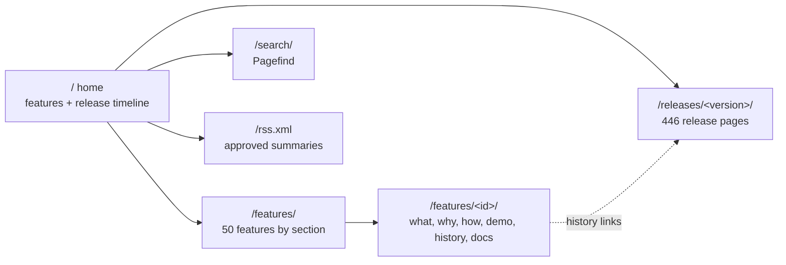
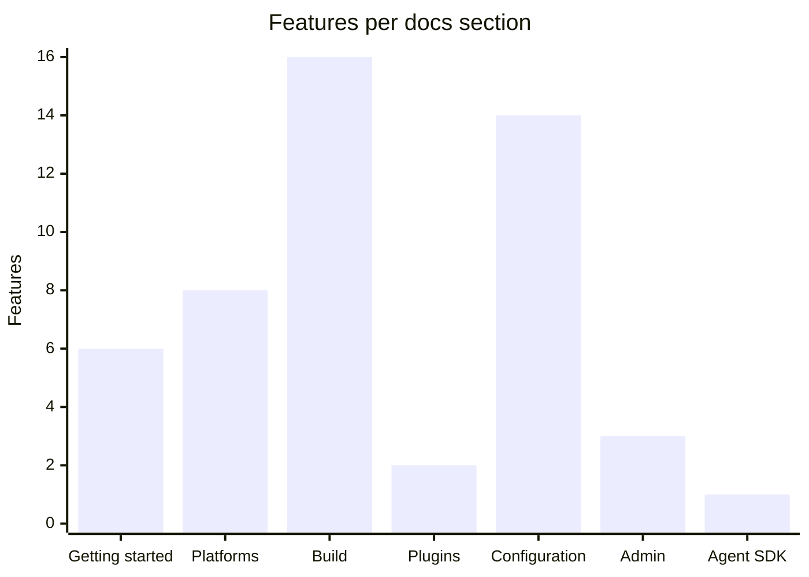
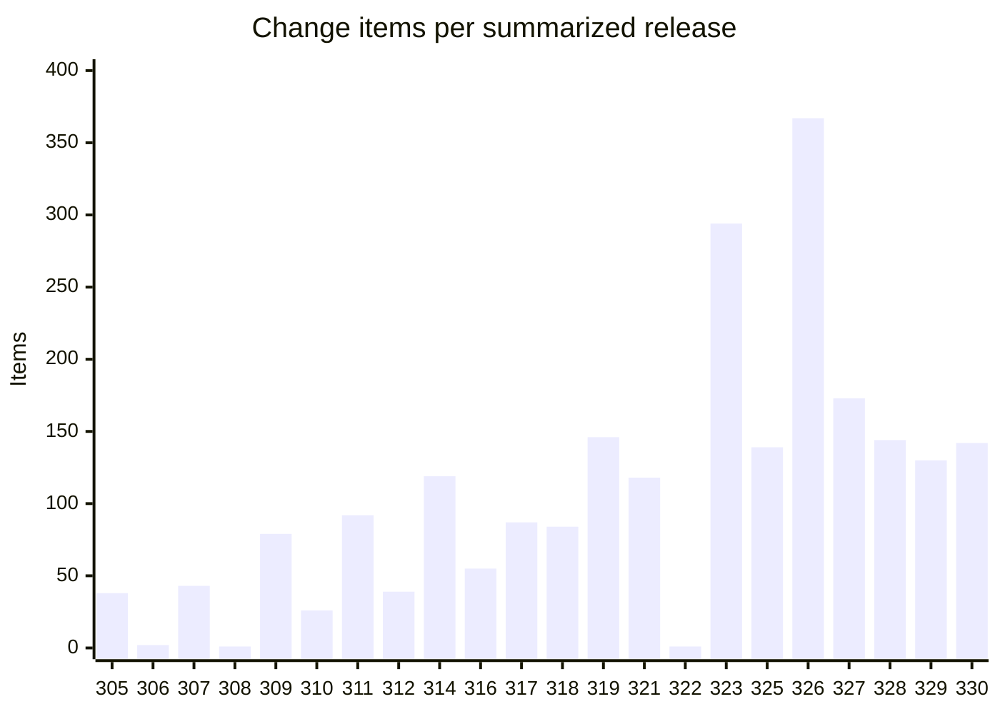
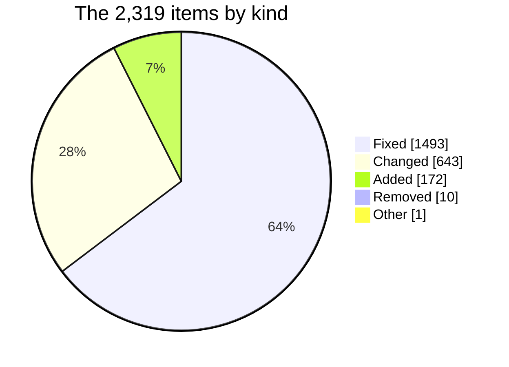
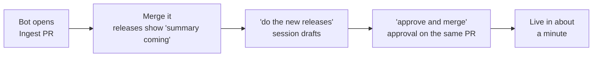

# Changelog Quest handbook

State on 2026-11-22. A snapshot of the whole project: what it is, how it is built, its data
model, rules, pipeline, site, content numbers, security and upkeep. Diagrams are Mermaid and
render on GitHub. Update this file (and its date) when the project changes in a way it
describes; git keeps the earlier versions.

| Releases tracked | Releases summarized | Summary lines | Feature pages | Demos | Decision records |
| ---------------: | ------------------: | ------------: | ------------: | ----: | ---------------: |
|              446 |                  22 |         1,443 |            50 |    50 |               16 |

## Contents

1. [Overview](#1-overview)
2. [Current state](#2-current-state)
3. [Architecture](#3-architecture)
4. [Data flow](#4-data-flow)
5. [Data model](#5-data-model)
6. [Rules](#6-rules)
7. [Pipeline](#7-pipeline)
8. [Website](#8-website)
9. [Content stats](#9-content-stats)
10. [Security](#10-security)
11. [Operations](#11-operations)
12. [Decisions](#12-decisions)
13. [Reference](#13-reference)

## 1. Overview

Claude Code ships new versions almost every day, and one release can list hundreds of
changes. The official changelog is complete but hard to skim. Changelog Quest is a static
website that turns it, and the Claude Code docs, into:

- **Release summaries**: every release since 2026-10-20 in our own words, grouped by week,
  with every change accounted for and a link to the original.
- **Feature pages**: 50 pages on what a feature is, why it matters, how it works and how it
  changed, checked against the official docs.
- **Scripted demos**: one small interactive example and quiz per feature. Fixed rules decide
  the result; no AI runs in the browser.

Principles:

- **Own words only.** Upstream changelog wording is never stored or published (ADR 0008).
- **Nothing lost.** Every change of a summarized release is classified, and summarized or
  counted (rule 5.1 in `conception.md`, section 6 here).
- **Human approval.** AI drafts are schema-checked; nothing is public until a person approves.
- **Simple and accessible.** Static pages, no tracking, keyboard and screen-reader friendly,
  light and dark themes.

Live site: <https://changelog-quest.pages.dev>

## 2. Current state

Phase 1 launched on 2026-11-22.

| Step | Deliverable                                                         | Status   |
| ---- | ------------------------------------------------------------------- | -------- |
| 0    | Workspace, CI, validator, docs and Claude skills                    | Done     |
| 1    | Zod schemas for every entity                                        | Done     |
| 2    | Strict changelog parser with fixture tests                          | Done     |
| 3    | npm dates and backfill of all past release records                  | Done     |
| 4    | Timeline of release cards with weekly grouping                      | Done     |
| 5    | Summaries drafted in Claude Code sessions                           | 22 done  |
| 6    | Daily GitHub Action updating one ingest pull request                | Running  |
| 7    | Feature catalog and demos                                           | 50 + 50  |
| 8    | Full site: home, features, demos, RSS, search, accessibility checks | Done     |
| 9    | Hosting and security headers                                        | Done     |
| 10   | Public launch                                                       | Launched |

Still open:

- Share the site, then watch whether people use it before planning more work.
- Optional custom domain (about $10 to $15 a year); `pages.dev` works until then.
- Phase 2, the Claude Developer Platform changelog, waits until phase 1 proves useful.

## 3. Architecture

A pnpm monorepo with three TypeScript packages and a content folder.

| Path        | Package        | Role                                                                                                                                   |
| ----------- | -------------- | -------------------------------------------------------------------------------------------------------------------------------------- |
| `schemas/`  | `@cq/schemas`  | Single source of truth for every content shape, plus pure shared rules: the coverage check and the demo engine. Runs in the browser.   |
| `pipeline/` | `@cq/pipeline` | Node scripts: changelog parser, upstream reader and verifier, ingest with npm dates, validator, hash ids, summary batches and builder. |
| `site/`     | `@cq/site`     | Astro static site. Re-validates `content/` at build; pure tested modules build the timeline, feature pages, RSS and navigation.        |
| `content/`  | data           | The database: releases, summaries, features, demos and ingest run logs, all JSON.                                                      |

Stack: TypeScript, Node 24, pnpm workspaces, Zod 4, Astro, Pagefind, Vitest, Biome, axe-core,
GitHub Actions, Cloudflare Pages.

## 4. Data flow

Releases are written only by the pipeline. Summaries, features and demos are written in
sessions or by hand and always land through a reviewed pull request; `main` requires the
`check` job.

## 5. Data model

The Zod schemas in `schemas/src/` are authoritative. Each entity is one file named after its key.

| File                               | Schema         | Written by                    | Notes                                                  |
| ---------------------------------- | -------------- | ----------------------------- | ------------------------------------------------------ |
| `content/releases/<version>.json`  | Release        | pipeline only                 | Ids and hashes, never the upstream text.               |
| `content/summaries/<version>.json` | ReleaseSummary | session draft, human approval | Holds classifications, the only item-to-feature link.  |
| `content/features/<id>.json`       | Feature        | by hand, from the docs        | Exactly one `introduced` event.                        |
| `content/demos/<featureId>.json`   | Demo           | by hand                       | At most one per feature.                               |
| `content/runs/<date>.json`         | IngestRun      | pipeline                      | Only when something changed or failed.                 |
| browser `localStorage`             | LocalProgress  | visitor                       | Tried demos, quiz answers, theme. Never sent anywhere. |

**Why item ids are hashes.** An id is the version plus a short hash of the normalized bullet,
for example `2.1.330#8d92bd8e`. If upstream inserts or reorders bullets, ids stay stable and
coverage and feature links don't break (ADR 0001). If a past section's text changes, its
`sourceHash` no longer matches and its summary is hidden until redrafted (ADR 0012).

## 6. Rules

Checked by `pnpm validate`, a required CI step on every pull request.

| Rule  | What it says                                                                                                                                                                             |
| ----- | ---------------------------------------------------------------------------------------------------------------------------------------------------------------------------------------- |
| 5.1.1 | Every item is classified and covered by a summary line, unless it is a small fix or change marked `minor`, which is counted instead. Added and removed items are never minor (ADR 0016). |
| 5.1.2 | Every line covers at least one real item of that release. The AI can't invent changes.                                                                                                   |
| 5.1.3 | Nothing is published unless its status is `approved`.                                                                                                                                    |
| 5.1.4 | If a past release's text changes, its summary is stale: hidden, a validation warning, and listed for a redraft.                                                                          |
| 5.1.5 | A line covering more than five items is a warning for the reviewer.                                                                                                                      |

Lifecycle of a summary:

**Demos** are plain rules: the first rule whose conditions all hold decides the outcome
(`success`, `blocked` or `info`) and the trace shown. Visitor input is only matched and echoed
as text. When a feature gets an `updated`, `deprecated` or `removed` event, its demo goes back
to draft.

## 7. Pipeline

One daily ingest run in GitHub Actions:

- **Strict parser.** Any unrecognised line fails the parse. Format changes are handled by
  extending the parser with a test, never by skipping lines.
- **Dates.** From npm; versions never on npm take the next newer version's time, shown as
  "by <date>" (ADR 0009).
- **Least privilege.** The write token is created after dependencies run, from a GitHub App
  installed on this repository only.
- **Summaries.** Drafted in Claude Code sessions, not through the API (ADR 0010).
  `pnpm summaries write` rejects anything that fails the schema or coverage.

## 8. Website

Static Astro output, about 500 pages.

**Navigation.** Features are grouped like the sections of the official Claude Code docs
(`site/src/lib/sections.ts`). A left sidebar lists them on the home, features, feature and
release pages; feature pages also have an "On this page" list and previous and next links. On
phones the sidebar becomes a "Browse all features" toggle.

Display rules:

- The timeline shows only releases since the cut-off, 2026-10-20, grouped by calendar week;
  older ones are reached through the official changelog (ADR 0015).
- Release cards start collapsed. A week with several versions becomes one digest card.
- A release without an approved summary shows "summary coming", its change count and a GitHub link.
- Minor items appear as "Plus N small fixes, listed in the original changelog".
- Update history on feature pages is collapsed, each version's changes behind their own toggle.
- Theme switch: system, light or dark, as an icon, remembered in the browser.

Quality gates on the built site: `pnpm check:dist` scans every page for inline scripts, styles
and event handlers and runs axe-core accessibility rules on a sample; the palette's contrast is
tested against WCAG AA in both themes.

## 9. Content stats

The 22 summarized releases (2026-10-20 to 2026-11-20) hold 2,319 change items.

Releases grew from about 40 to 90 items in October to 130 to 370 in November. That is why
ADR 0016 lets small fixes be counted instead of each getting its own line.

Features most often touched by recent changes (linked items):

| Feature                   | Items |
| ------------------------- | ----: |
| IDE integrations          |   184 |
| Permissions               |   173 |
| MCP servers               |   166 |
| Claude Code on the web    |   158 |
| Cloud providers           |   145 |
| Subagents                 |   141 |
| Self-hosted environments  |   132 |
| Settings                  |   126 |
| Plugins                   |   125 |
| Remote Control and mobile |   109 |

Feature areas (card colour): built in 27, extend 10, use anywhere 13. Demo kinds: choose from
options 45, type free text 5.

## 10. Security

No logins, forms, database or API exposed to visitors.

- **Untrusted text.** Changelog text, AI output and visitor input are data, rendered with
  `textContent`, never as HTML and never executed.
- **Schema gate.** AI output that fails the schema or coverage is rejected, never patched.
- **One secret.** The ingest GitHub App key, only as an Actions secret. Nothing calls the
  Claude API.
- **Repository hygiene.** Protected `main`, required `check` job, pinned action versions,
  Dependabot.
- **Privacy.** No analytics or cookies; visitor progress stays in the browser.

Headers served by Cloudflare Pages (`site/public/_headers`):

| Header                       | Effect                                                                                                 |
| ---------------------------- | ------------------------------------------------------------------------------------------------------ |
| `Content-Security-Policy`    | Same-origin scripts, styles, fonts, images only; no inline code; WebAssembly for Pagefind; no framing. |
| `Strict-Transport-Security`  | HTTPS for a year, subdomains included.                                                                 |
| `X-Content-Type-Options`     | `nosniff`                                                                                              |
| `X-Frame-Options`            | `DENY`                                                                                                 |
| `Referrer-Policy`            | `strict-origin-when-cross-origin`                                                                      |
| `Permissions-Policy`         | Camera, microphone, location, payment and other device APIs off.                                       |
| `Cross-Origin-Opener-Policy` | `same-origin`                                                                                          |

## 11. Operations

| When                                 | What                                                               |
| ------------------------------------ | ------------------------------------------------------------------ |
| Every day, 06:17 UTC                 | The ingest runs on its own and writes only when something changed. |
| When the ingest PR appears           | Merge it, then draft and approve the new summaries.                |
| Weekly                               | Check GitHub emails for a failed ingest; merge Dependabot updates. |
| When Claude Code ships a big feature | Add or update its page; its demo goes back to draft for review.    |

Project skills (`.claude/skills/`): `draft-summary`, `review-summary`, `add-feature`,
`write-demo`, `record-decision`.

## 12. Decisions

Every change from the first design is recorded in [`docs/decisions/`](decisions/).

| ADR  | Decision                                                             |
| ---- | -------------------------------------------------------------------- |
| 0001 | Change item ids are text hashes, not positions.                      |
| 0002 | Classifications live in summaries; the only source of feature links. |
| 0003 | Releases without an approved summary show as short pending cards.    |
| 0004 | Backfill with a summary cut-off date.                                |
| 0005 | Tooling: pnpm, Biome, Vitest, Zod.                                   |
| 0006 | The daily pipeline updates one bot pull request.                     |
| 0007 | Weekly digests, review aids and staleness checks.                    |
| 0008 | Publish only our own words; never store upstream text.               |
| 0009 | Dates from npm, estimated when a version was never published.        |
| 0010 | Summaries drafted in Claude Code sessions, not through the API.      |
| 0011 | Host on Cloudflare Pages for headers and previews.                   |
| 0012 | A changed release's summary is hidden, not a validation error.       |
| 0013 | Summaries only for recent releases; features come first.             |
| 0014 | A readable palette and typefaces of our own.                         |
| 0015 | The timeline shows only releases since the cut-off.                  |
| 0016 | Small changes are counted instead of summarized one by one.          |

## 13. Reference

Run from the repository root with Node 24 and pnpm.

| Command                                     | What it does                                                          |
| ------------------------------------------- | --------------------------------------------------------------------- |
| `pnpm check`                                | Lint, typecheck, test, validate, build and check the built site (CI). |
| `pnpm validate`                             | Schemas, ids, cross-references and coverage on `content/`, offline.   |
| `pnpm source show <version>`                | Print a version's upstream bullets with item ids, for review only.    |
| `pnpm source verify`                        | Re-check stored hashes and ids against upstream.                      |
| `pnpm ingest`                               | Add new or changed releases from upstream.                            |
| `pnpm summaries pending`                    | The next batch of releases to summarize.                              |
| `pnpm summaries write <draft> --model <id>` | Build a draft summary file from a session draft.                      |
| `pnpm dev` / `pnpm dev:drafts`              | Local site, optionally showing drafts.                                |
| `pnpm build`                                | Static site and search index into `site/dist`.                        |

Other documents: [`conception.md`](conception.md) (design, data model, rules, build plan),
[`architecture.md`](architecture.md) (packages, invariants, trust boundaries),
[`operations.md`](operations.md) (how-tos), [`todo.md`](todo.md) (what is left), and the
`CLAUDE.md` file in each package.
